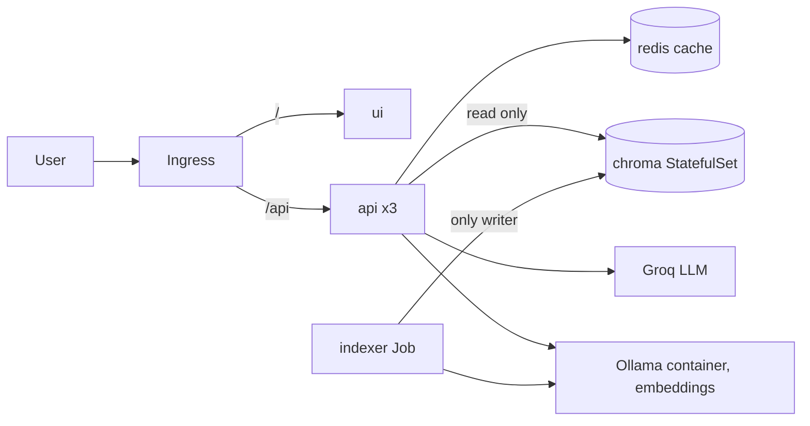

# RAHBAR

[](https://github.com/CapsuleFlyer/rahbar/actions/workflows/ci.yml)

Team: CapsuleFlyer and AbubakrQ.

RAHBAR answers questions only from a real document corpus (the D&D 5th-edition rules), cites its sources and says
"the corpus does not cover this" when it cannot answer. It runs on Kubernetes: an indexer Job writes the vector
store, an api reads it, and a semantic cache sits in Redis.

Corpus: the D&D 5th-edition rules, all public. The two System Reference Documents (SRD 5.1, 2014 and
SRD 5.2.1, 2024) are CC-BY-4.0 and committed in `corpus/raw/`; the other four (Sage Advice Compendium and three
errata PDFs) are **not** committed: `corpus/sources.yaml` + `corpus/MANIFEST.md` (URLs and SHA-256) +
`corpus/fetch.py` recreate them. See `docs/CORPUS.md`. Answers are generated by Groq's free hosted API; embeddings come from a small Ollama model (`nomic-embed-text`) on your machine (ADR 0004).

> This work includes material from the System Reference Document 5.1 ("SRD 5.1") and the System Reference
> Document 5.2.1 ("SRD 5.2.1") by Wizards of the Coast LLC, licensed under the Creative Commons Attribution 4.0
> International License (https://creativecommons.org/licenses/by/4.0/legalcode).



## Prerequisites (Windows 11 + WSL2, also fine on Linux/macOS)
Run everything below in an **Ubuntu (WSL2) terminal**, with the repo cloned inside the Ubuntu home folder.
1. Docker Desktop, with Settings > Resources > WSL integration switched on for your Ubuntu distro.
2. In Ubuntu: `make`, `curl`, `git`, Python 3.12, `kubectl` and `minikube` (Python 3.12 on Ubuntu 22.04 comes from the
   `ppa:deadsnakes/ppa` repository).
3. A free Groq API key from console.groq.com (no card needed).
4. `poppler-utils` for rasterizing the scanned PDF: `sudo apt install -y poppler-utils`.

Ollama (embeddings only) runs as a **container on the minikube Docker network**, not on your PC. The host-gateway
address `host.minikube.internal` could not reach an Ollama installed on Windows or in WSL (Docker Desktop's gateway is a
different network), so the NetworkPolicies and the ConfigMap point at `192.168.49.10`. Start it once, after `make cluster`:
```bash
docker run -d --name ollama --network minikube --ip 192.168.49.10 \
  -v ollama-models:/root/.ollama --restart unless-stopped ollama/ollama
docker exec ollama ollama pull nomic-embed-text
```
If you ever recreate minikube, run `docker rm -f ollama` first and repeat the commands (the `ollama-models` volume keeps the model).

## From a clean clone to an answer
```bash
chmod +x scripts/*.sh scripts/ci/*.sh  # only needed if your clone lost the executable bit
make install PY=python3.12         # .venv for fetch/eval tooling
make cluster                       # minikube + Calico + metrics-server + ingress
# now start the Ollama container (command above)
make images                        # build and load the 3 images
kubectl apply -k k8s/overlays/dev  # namespace, config, chroma, redis, api, ui, ingress, indexer Job
export LLM_API_KEY='gsk_...your groq key...'; make secret   # key goes to the cluster only, never to a file
kubectl -n rahbar rollout restart deployment/api  # pods read the Secret at start
make fetch                         # download the corpus
make corpus-load                   # copy it into the corpus PVC; the indexer Job starts reading it
kubectl -n rahbar wait --for=condition=complete job/indexer --timeout=15m
echo "$(minikube ip) rahbar.local" | sudo tee -a /etc/hosts
make ask Q="What DC does the Hide action need?"          # a grounded, cited answer
make ask Q="What is a mind flayer's Mind Blast?"        # not in the corpus: must decline (answered_from_context false)
```
**Check the embedding link before the indexer runs** (the output must list `nomic-embed-text`):
```bash
minikube ssh "curl -s http://192.168.49.10:11434/api/tags"
```
The same address is set in two places that must agree: `OLLAMA_URL` in `k8s/base/configmap.yaml` and the two `ipBlock`
rules (`api-egress`, `indexer-egress`) in `k8s/base/networkpolicy.yaml`.

**Browser on Windows.** `minikube ip` is only reachable from inside WSL. To open the UI from Windows, run
`minikube tunnel` in a spare Ubuntu terminal and add `127.0.0.1 rahbar.local` to
`C:\Windows\System32\drivers\etc\hosts` (as administrator), then browse to http://rahbar.local.

Re-index with no redeploy: `kubectl create job --from=cronjob/reindex manual-reindex-1 -n rahbar`.
Generation uses `openai/gpt-oss-20b` on Groq (`LLM_MODEL` in the ConfigMap; Groq retired `llama-3.1-8b-instant` on 2026-08-16, which shows up as `HTTP 404` in the api log).
The Groq free tier is rate-limited per minute; if answers come back slowly or as a safe fallback, wait a minute and retry.
Secrets are never committed.

## Troubleshooting (all hit for real)
| Symptom | Cause | Fix |
| --- | --- | --- |
| `chroma-0` in CrashLoopBackOff, log says `found string "tcp://..." expected u16 for key "PORT"` | The Service named `chroma` injects `CHROMA_PORT=tcp://...`, which Chroma reads as config | `enableServiceLinks: false` on the pod (already set) |
| Indexer log says `ConnectError` to the embedding URL | Ollama not reachable from the cluster | Start the Ollama container (above) and re-run the `curl` check |
| Indexer Job `Failed`, no pod, `BackoffLimitExceeded` | A pod was deleted by hand, which counts as a failure | Never delete the pod: `kubectl -n rahbar delete job indexer && kubectl apply -k k8s/overlays/dev` |
| `make ask` hangs or prints a JSON error | `minikube ip` is not reachable from WSL | `minikube tunnel` in a second terminal, then `make ask INGRESS_IP=127.0.0.1 Q="..."` |
| Answers are always the safe fallback, api log says `provider failed ... HTTP 404` | Wrong or retired Groq model, or a bad key | Check `LLM_MODEL` against console.groq.com/docs/models; re-run `make secret` |

## API
| Method | Path | Purpose |
| --- | --- | --- |
| GET | /healthz | liveness, touches no dependency |
| GET | /readyz | Chroma reachable, collection non-empty, Redis reachable, embedding pin matches |
| GET | /metrics | Prometheus metrics |
| POST | /api/ask | `{"question": "..."}` returns a cited answer or an honest abstention |

See `docs/` for corpus, pipeline, failure analysis, ADRs and engineering notes.

## RAGOps (Assignment 03)

Commands for each part are added here as the parts are built. Everything below runs against the
cluster from the sections above (`make cluster`, `make images`, `kubectl apply -k k8s/overlays/dev`).

### Part A: verification and incremental ingestion
The ingestion Job is the only writer to Chroma. Its data lake is the `corpus-data` volume: active
documents in the root, plus `quarantine/` (failed verification, with a `.reason.json`), `archive/`
(superseded versions, restorable) and `reports/` (one verification report per run, JSON and Markdown).
Thresholds are in the ConfigMap (`NEAR_DUP_THRESHOLD`, `MIN_CHARS_PER_PAGE`, `MIN_WORDLIKE_RATIO`).

```bash
make ingest                                     # run the Job now; prints the verification report and chunk counts
make batch-load DIR=eval/batch_b/docs && make ingest      # Batch B: 12 documents with planted problems
make ops ARGS="list"                            # active, archived and quarantined documents
make ops ARGS="counts"                          # chunks per document in Chroma
make ops ARGS="counts --source retired-downtime-activities.md"      # 0 chunks: nothing quarantined is indexed
make ingest                                     # unchanged corpus: "chunks embedded: 0"
make ops ARGS="delete homebrew-optional-rules.md" && make ingest    # then: counts --source ... shows no orphan chunks
make ops ARGS="rollback sage-advice-compendium-v2-7-2021.pdf" && make ingest    # restore the old version, archive the newer one
```
Batch B is generated by `python eval/batch_b/make_batch_b.py` (ground truth in `eval/batch_b/expected.json`);
`python eval/batch_b/check_report.py <report.json>` compares a run with it.

**How the four checks work.** quality: text exists, is not nearly empty and is not garbled (share of word-like
tokens). completeness: title, source, version or date and a page count exist, and the file is not cut off (a PDF
without its end marker, or text that stops mid-sentence). recency: a newer version of the same document (same title
without version or year) is present: the old one is archived, not quarantined. uniqueness: exact duplicates by
SHA-256 of the file or the text; near-duplicates by cosine similarity of document vectors (sampled passages), confirmed
by shared wording so two editions of one rule book are not mistaken for copies. An injected instruction is only a
warning here: the document is indexed so the query-time guardrail can be demonstrated.

**How it stays incremental.** Each chunk stores a hash of its text, and each document stores the SHA-256 of its file and
a signature of the chunking and embedding settings. An unchanged document is skipped without being extracted. A changed
one is re-chunked and compared chunk by chunk: identical text keeps its vector, only new text is embedded, vanished
chunks are deleted. The cache generation (`index_id`) changes only when something changed.

### Part D: traces and observability
Every query writes one JSON trace line: to stdout (`kubectl logs`) and to `/traces/traces-<pod>.jsonl`
on the `traces-data` PersistentVolumeClaim.

```bash
make ask Q="What DC does the Hide action need?"        # the reply ends with "trace: <id>"
make trace ID=<id>                                      # D2: the exact context and prompt behind that answer
make trace-report SINCE=1h                              # D3: cache hit rate, abstentions, top-1 similarity, p50/p95 per stage, injection flags
kubectl -n rahbar logs -l app.kubernetes.io/name=api --tail=3 --prefix | grep '"msg": "trace"'   # F4
kubectl -n rahbar port-forward svc/api 8000:8000 &  curl -s localhost:8000/metrics | grep rahbar_   # F4: metrics
```
Guardrail actions (D4) are recorded in the `guardrails` field of the trace and counted in
`rahbar_injection_flagged_total`.
