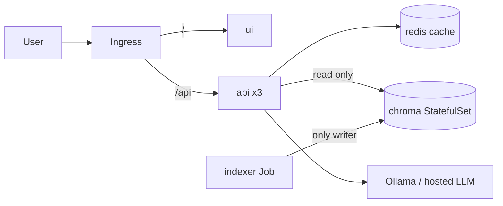

# RAHBAR

[](https://github.com/CapsuleFlyer/rahbar/actions/workflows/ci.yml)

Team: CapsuleFlyer and AbubakrQ.

RAHBAR answers questions only from a real document corpus (the D&D 5th-edition rules), cites its sources and says
"the corpus does not cover this" when it cannot answer. It runs on Kubernetes: an indexer Job writes the vector
store, an api reads it, and a semantic cache sits in Redis.

Corpus: the D&D 5th-edition rules, all public. The two System Reference Documents (SRD 5.1, 2014 and
SRD 5.2.1, 2024) are CC-BY-4.0 and committed in `corpus/`; the other four (Sage Advice Compendium and three
errata PDFs) are **not** committed: `corpus/sources.yaml` + `corpus/MANIFEST.md` (URLs and SHA-256) +
`corpus/fetch.py` recreate them. See `docs/CORPUS.md`. Embeddings and generation go through Ollama on the host.

> This work includes material from the System Reference Document 5.1 ("SRD 5.1") and the System Reference
> Document 5.2.1 ("SRD 5.2.1") by Wizards of the Coast LLC, licensed under the Creative Commons Attribution 4.0
> International License (https://creativecommons.org/licenses/by/4.0/legalcode).



## From a clean clone to an answer
```bash
make cluster                       # minikube + Calico + metrics-server + ingress
make images                        # build and load the 3 images
kubectl apply -k k8s/overlays/dev  # namespace, config, chroma, redis, api, ui, ingress, indexer Job
cp corpus/sources.example.yaml corpus/sources.yaml; make fetch   # download the corpus
make corpus-load                   # copy it into the corpus PVC; the indexer Job starts reading it
kubectl -n rahbar wait --for=condition=complete job/indexer --timeout=15m
echo "$(minikube ip) rahbar.local" | sudo tee -a /etc/hosts
make ask Q="What is the minimum attendance to sit the final exam?"
```
The `dev` overlay starts in stub mode (dummy index); see `k8s/README.md` to switch to the real pipeline.
Re-index with no redeploy: `kubectl create job --from=cronjob/reindex manual-reindex-1 -n rahbar`.
LLM key (hosted mode only): `export LLM_API_KEY=...; make secret`. Secrets are never committed.

## API
| Method | Path | Purpose |
| --- | --- | --- |
| GET | /healthz | liveness, touches no dependency |
| GET | /readyz | Chroma reachable, collection non-empty, Redis reachable, embedding pin matches |
| GET | /metrics | Prometheus metrics |
| POST | /api/ask | `{"question": "..."}` returns a cited answer or an honest abstention |

  <!-- TODO: add after the first run -->

See `docs/` for corpus, pipeline, failure analysis, ADRs and engineering notes, and `MANUAL-STEPS.md` for what is still open.
